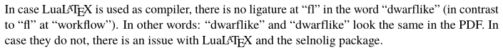
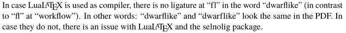

# Use lualatex for correct ligatures

Technical Story: <https://github.com/latextemplates/scientific-thesis-template/issues/54>

## Context and Problem Statement

A [ligature](https://en.wikipedia.org/wiki/Typographic_ligature) is the joining of letters to look better.
Typographic rules forbid ligatures at "morpheme boundaries".
See [english.stackexchange.com](https://english.stackexchange.com/q/50660/66058) for a long discussion.

Example with correct ligatures:

Example with wrong ligatures:

See a German rant on wrong ligatures: <https://web.archive.org/web/20150425155310/http://www.mengensatz.de/blog/?p=79>.
For instance, in the English word "offline", the letters "f" and "l" must not form a ligature.
In the German word "Auflage", the letters "f" and "l" must not form a ligature.
See also the last lines in <https://tex.stackexchange.com/a/64457/9075>.

### More readings

* <https://www.typolexikon.de/ligatur/>
* Questions on ligatures: <https://tex.stackexchange.com/questions/tagged/ligatures>
* Disable ligatures in headings: <https://tex.stackexchange.com/q/198743/9075>

## Considered Options

* Use lualatex+selnolig
* Use a post-processor
* Suppress all ligatures
* Ignore ligature issues

## Decision Outcome

Chosen option: "lualatex", because comes out best (see below).

## Pros and Cons of the Options

### Use lualatex+selnolig

The only way to keep ligatures where appropriate is to switch to [lualatex](http://www.luatex.org/).
There is [selnolig](https://www.ctan.org/pkg/selnolig).
Found going from <https://tex.stackexchange.com/q/28437/9075> to <https://tex.stackexchange.com/q/63005/9075> and then to <https://tex.meta.stackexchange.com/questions/2884/new-package-selnolig-that-automates-suppression-of-typographic-ligatures>

* Good, because disables at the right places and not everywhere
* Bad, because needs switch of LaTeX compiler to lualatex, which users are not used to

### Use a post-processor

* perl-based solution: <http://ctan.org/pkg/rmligs>
* java-based solution: <http://www.ctan.org/pkg/delig>  (used by @sieversmartin)
* C-based solution (working for German documents only): <https://ctan.org/pkg/ligatex>

* Good, because proven solutions
* Good, because works with pdflatex
* Bad, because it uses babel's `"|` shortcut, which produces correct results in the case of "fl" and the font "latin modern" only.
  See <https://tex.stackexchange.com/a/389439/9075> for a long explanation.
* Bad, because tex files change

### Supress ligatures completely

See <https://tex.stackexchange.com/q/61042/9075> and <https://tex.stackexchange.com/q/1841/9075>

* Good, because easy to implement
* Good, because works with pdflatex
* Bad, because ligatures look better

### Ignore ligature issues

* Good, because LaTeX users expect ligatures everywhere
* Good, because works with pdflatex
* Bad, because higher-quality typesetting is possible

## More Information

The options and their pros and cons in general: [How to avoid wrong ligatures](https://github.com/latextemplates/gadr-latex-packages/blob/main/ligatures.md).
