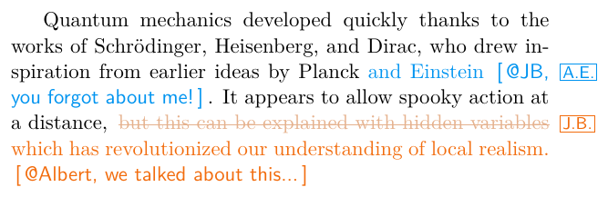
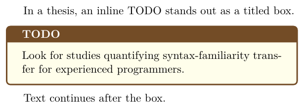

# Use phfcc for edits and comments by several authors

## Context and Problem Statement

When several people write a paper or when a supervisor reviews a thesis, additions, removals and remarks have to be visible in the PDF and attributable to their author.
The templates offered only single-author marks (`\change`, `\modified`, `\textmarker`) and PDF annotations ([generator-latex-template#143](https://github.com/latextemplates/generator-latex-template/issues/143)).
How to mark edits and comments by several authors?

## Considered Options

* [phfcc](https://ctan.org/pkg/phfcc)
* [changes](https://ctan.org/pkg/changes)
* [todonotes](https://ctan.org/pkg/todonotes) only
* [latexdiff](https://ctan.org/pkg/latexdiff) between versions

## Decision Outcome

Chosen option: "phfcc", because one `\phfMakeCommentingCommand` per author gives a single short command for everything: `\FA{added}`, `\FA*{removed}`, `\FA[comment]`, `\FA!{important}`, with the initials once per page in the margin instead of at every mark, and `\phfDisableCommentingCommands` hides everything for the final version.
With LuaLaTeX, the `rmstrikethrough` style strikes removed text through across line breaks (lua-ul, which the templates load anyway); the `footcomments` style moves comments into footnotes so that the layout stays intact when checking page limits.

Separately, the thesis documents with `--todo=todonotes` set inline TODOs as a titled tcolorbox, which stands out in a long text better than todonotes' plain colored bar:

### Consequences

* Good, because the template defines `\FA` ("first author") and a second author needs one more line in the preamble.
* Good, because the existing `\textcomment` and `\sidecomment` (PDF annotations) stay as they are; phfcc adds in-text marks, it does not replace them.
* Bad, because the margin initials need a margin; in two-column papers they sit in the narrow outer margin.

## More Information

The options and their pros and cons in general: [How to track changes by several authors](https://github.com/latextemplates/gadr-latex-packages/blob/main/change-tracking.md).
