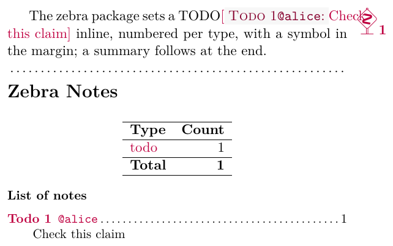

# Use zebra for TODOs

## Context and Problem Statement

The templates offered `pdfcomment` (default) and `todonotes` for TODOs.
With `pdfcomment`, a TODO is only "TODO!" in the text and the note itself is a PDF annotation, which not every PDF viewer shows.
`todonotes` needs a wide margin, which two-column papers do not have, and its notes and leader lines overlap when several notes are close to each other.
How to mark TODOs?

## Considered Options

* [zebra](https://ctan.org/pkg/zebra)
* [todonotes](https://ctan.org/pkg/todonotes), with [luatodonotes](https://ctan.org/pkg/luatodonotes) under LuaLaTeX
* [pdfcomment](https://ctan.org/pkg/pdfcomment)
* [fixme](https://ctan.org/pkg/fixme)

## Decision Outcome

Chosen option: "zebra" as default for papers and theses, because the notes are short inline text with only a small numbered symbol in the margin, which works in the narrow margins of two-column papers, nothing overlaps, and a summary and a list of all open notes follow at the end of the document.
`\todo[name]{...}` names who is responsible, and `\note`, `\fixed`, and `\placeholder` are further note types.
`\usepackage[final]{zebra}` hides all notes and the lists for the final version.

`todonotes` and `pdfcomment` stay selectable (`--todo=todonotes`, `--todo=pdfcomment`).
With `--todo=todonotes`, documents compiled with LuaLaTeX load `luatodonotes`, a drop-in replacement that places the notes so that notes and lines do not overlap; with `--latexcompiler=both`, an `\ifluatex` switch loads `todonotes` under pdfLaTeX.

### Consequences

* Good, because the notes are visible in every PDF viewer and in print, and the list at the end shows what is still open.
* Good, because `phfcc` (edits by several authors, [ADR-0024](0024-use-phfcc-for-edits-by-several-authors.md)) stays as it is: zebra is for TODOs, phfcc for edits.
* Bad, because the notes stand in the text and take space; for checking a page limit, the `final` option has to be set.
* Bad, because KOMA-Script's class option `draft=false` reaches zebra as a global option and would hide all notes, so the templates load zebra with an explicit `draft` option.
* Bad, because zebra does not redefine commands that another package defined first: `\comment` is the comment environment of `verbatim` (loaded by `mindflow`) and `comment` (loaded by `acmart`). The templates redefine `\comment` so that `\begin{comment}` still comments out and `\comment[name]{...}` elsewhere is a zebra note.

## More Information

The options and their pros and cons in general: [How to mark TODOs](https://github.com/latextemplates/gadr-latex-packages/blob/main/todo-package.md).
